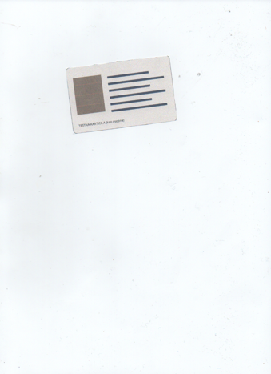
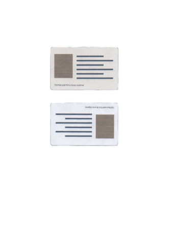

# id2pdf

Scan both sides of an ID card onto one A4 page, as a PDF: like a photocopy, at real size.

Put the card anywhere on the scanner glass, also a little askew. id2pdf scans the whole glass
quickly, finds the card, scans only that spot at full resolution, straightens it and cuts it out.
Then the same for the back.

| On the glass | The PDF |
|---|---|
|  |  |

It works with any card of ID-1 size (85.6 × 54 mm): ID cards, driving licences, health
insurance cards, residence permits. Everything happens on your computer.

## Install

Linux with a scanner that SANE supports (`scanimage -L` lists it):

```
uv tool install id2pdf      # or: pipx install id2pdf
```

From a clone of this repository: `uv tool install .`

## Use

```
id2pdf id_card.pdf                                  # scan the front, then the back
id2pdf id_card.pdf --images front.jpg back.jpg      # from existing scans or photos
id2pdf pages.pdf --pages 3                          # three plain A4 pages instead of a card
id2pdf --diagnose ~/id2pdf-diagnose                 # what is found on the glass, as numbers
```

Options: `--device` picks the scanner (default: the first one in `scanimage -L`), `-f` overwrites
the output without asking.

The card's text should be upright on the glass: a slight turn is straightened, but a card upside
down stays upside down.

Messages are in English or Croatian, following `LANGUAGE` / `LANG`.

## How the card is found

- A quick scan of the whole glass at 100 dpi. The card shows as sharp edges (its outline and
  print) and areas clearly darker than the lid; the lid's own shading is gradual and only
  slightly darker, and dust is too small to make a card shape.
- A plastic card lifts the lid, which casts a shadow up to about 10 mm wide around it. Inside the
  object found, a rectangle of the card's exact size is placed on the sharpest edges: the card's
  edge is a sharp step, the shadow a soft one. Every side has to lie on an edge.
- Only that spot is scanned at 300 dpi, the card is found again there, straightened, cut out, and
  the lid showing at its rounded corners is painted white.
- A network scanner that is still busy from the previous scan is asked again a few times.

If a card is not found, `--diagnose` prints the size and position of every object on the glass
and why it was not taken for a card; the scan itself is saved only locally.

## Use as a library

```python
from pathlib import Path

import id2pdf

id2pdf.set_language("hr")
device = id2pdf.find_scanner()
page = id2pdf.scan_id_card(device)              # a PIL image of the A4 page
id2pdf.save_pdf([page], Path("id.pdf"), id2pdf.CARD_DPI)
```

## Development

```
uv sync
uv run pytest
uv run ruff check . && uv run ruff format --check .
./tools/update_translations.sh                  # after changing messages; needs gettext
uv run tools/test_cards.py                      # docs/test_cards.pdf
```

The tests run on real scans of the whole glass of an Epson XP-255 (`tests/data`), made with the
printed test cards from `docs/test_cards.pdf`, and on the same scans with a simulated shadow;
scanning goes through a fake `scanimage`. To test with another scanner, print the test cards,
cut them out and scan the glass at 100 dpi:
`scanimage --mode Color --resolution 100 --format=png > glass.png`.
Please never add scans of real cards.

Translations: `src/id2pdf/locale/<language>/LC_MESSAGES/id2pdf.po`.

## Licence

GPL-3.0-or-later, see [LICENSE](LICENSE).
